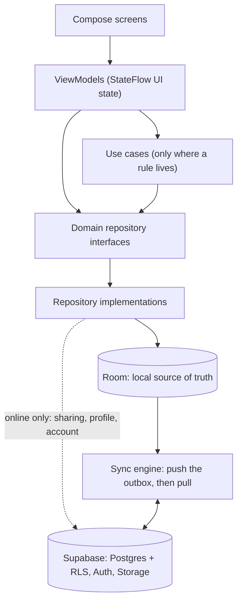

# Giftiary

[](https://github.com/Antal-Timea/giftiary/actions/workflows/android.yml)


Giftiary is a native Android app for remembering, planning and sharing gifts.

- **Remember:** keep a history of the gifts you gave and received, and of gifts between other people
  (for example from a grandparent to a grandchild).
- **Plan:** keep track of the people who matter to you and their birthdays, name days and other
  occasions. Collect gift ideas and move them from *idea* to *planned* to *purchased*. Marking an
  idea as given turns it into a gift.
- **Share:** keep wishlists and share one privately by link or by email invitation. Guests can
  reserve a wish. On your own list you never learn whether a wish was reserved, or by whom, so the
  surprise is kept.

Everything you add is saved on the phone first and works without a network. A Supabase backend
syncs it between your devices and handles sharing.

The app is in closed testing (Android only, English and Hungarian).

<br clear="right">

## Screenshots

Screenshots of the current build are not in the repository yet. The image above is one of the
app's own bundled illustrations.

## Engineering highlights

- **Offline-first writes.** Room is the local source of truth and the UI observes it. Every user
  change is one Room transaction that updates the entity *and* records a pending sync operation,
  so a crash can never leave a saved change that will not be synced.
- **A coalescing outbox.** There is at most one pending operation per entity. Create + update stays
  a create, update + delete becomes a delete, and so on. Sync sends the current state of a row, not
  a replay of every edit.
- **Optimistic concurrency.** Every synced row carries a version, and the server accepts a write
  only against the version the client last saw. Each write also carries a client-generated
  mutation id, recorded in the same database transaction. When a request times out, the app looks
  that id up instead of guessing whether the write happened. A conflict is settled in favour of the
  server copy, and the local edit is kept as a visible conflict.
- **Client-generated UUIDs.** The same id is used in Room and in Postgres. Deletes are soft
  (`deleted_at`), so other devices learn about them on their next sync.
- **Privacy enforced by the backend, not the UI.** Row Level Security limits every private table
  to its owner. Shared wishlists, memberships and reservations are reachable only through Postgres
  functions. The owner of a list never receives reservation data for their own list.
- **Account deletion.** Deleting the account removes it on the server, and the app clears the
  device. The account's other devices clear their copy too, once the server confirms the account
  is gone.
- **Tests on both sides.** Android unit, Robolectric and Compose tests cover the sync engine, Room
  migrations, auth links and view models. pgTAP tests check the database rules, including RLS and
  concurrent reservations.

## Architecture

A single Gradle module with three layers: `presentation`, `domain` and `data`.



- **Composables** render immutable state and send user actions to their ViewModel.
- **ViewModels** call a domain repository directly when nothing more than loading or saving is
  involved. **Use cases** exist where there is a real rule or orchestration, for example
  validating and saving a gift, or computing upcoming occasions. Not every call goes through a use
  case.
- **The domain layer** is plain Kotlin, with no Android, Room or Supabase types.
- **Repositories** own their data sources. User data goes through Room and is synced later.
  Collaborative features (shared lists, reservations, invitations) are server-authoritative and go
  online through Postgres functions.
- **Sync** pushes pending changes first, parents before children, then pulls the account's rows.
  It runs when the app comes to the foreground and in a periodic WorkManager job.

**Stack:**
- Kotlin, Jetpack Compose with Material 3, Coroutines and Flow, Hilt, Room (KSP), Navigation
  Compose (type-safe routes), kotlinx.serialization, WorkManager.
- supabase-kt (Auth, PostgREST, Storage) over Ktor/OkHttp.
- Sign-in uses email and password, or Google/Facebook through Supabase in a browser tab, with PKCE.
- `minSdk` 26, `targetSdk` 37.

## Repository layout

| Path | What it is |
|---|---|
| [`giftiary-android/`](giftiary-android) | The Android app. Source in `app/src/main/java/app/giftiary/{presentation,domain,data,di}`, Room schema history in `app/schemas/` |
| [`supabase/`](supabase) | Backend: SQL migrations, RLS policies, Postgres functions and pgTAP tests. [`supabase/README.md`](supabase/README.md) explains the data model and access rules |
| [`docs/legal/`](docs/legal) | Privacy policy texts (English and Hungarian) and the data inventory behind them |
| [`docs/release-checklist.md`](docs/release-checklist.md) | How a build goes from `develop` to testers |

## Building and testing

The Android project lives in `giftiary-android/` and builds with the Gradle wrapper (the Gradle
daemon uses JDK 25). Every task below runs without backend credentials: unit tests use fakes, and
debug builds only warn when Supabase is not configured.

```bash
cd giftiary-android
./gradlew :app:testDebugUnitTest   # unit, Robolectric and Compose tests
./gradlew :app:lintDebug
./gradlew :app:assembleDebug
```

GitHub Actions runs these three tasks on every pull request and on pushes to `develop` and
`master` ([`android.yml`](.github/workflows/android.yml)).

The database tests run against a local Supabase stack. They need Docker and the
[Supabase CLI](https://supabase.com/docs/guides/local-development/cli/getting-started). From the
repository root:

```bash
supabase start      # local Postgres, Auth and Storage in Docker
supabase db reset   # apply every migration in supabase/migrations
supabase test db    # run the pgTAP tests in supabase/tests/database
supabase stop
```

The pgTAP tests are not part of CI yet.

Development was AI-assisted: much of the implementation was done with Claude Code, under the
owner's direction and review.

## Running the app

The app needs a Supabase backend. Its address and publishable key are read from
`giftiary-android/local.properties`, which is git-ignored:

```properties
sdk.dir=/path/to/Android/sdk
supabase.url=https://<your-project-ref>.supabase.co
supabase.publishableKey=<your project's publishable key>
# Optional: show the Google / Facebook buttons only once those providers are set up in your project.
# auth.google.enabled=true
# auth.facebook.enabled=true
```

**To run it against your own Supabase project:**
1. Create a project.
2. Apply `supabase/migrations` (`supabase link`, then `supabase db push`).
3. Add `giftiary://auth/callback` and `giftiary://auth/recovery` to the project's Auth redirect URLs.
4. Fill in the two values above.

Invitation emails are only sent once a Resend API key is stored in the project's Vault (see
[`supabase/README.md`](supabase/README.md)). Without it, email invitations still appear in the
recipient's app.

Without these settings a debug build still compiles, but the app stops at startup when it first
needs the backend.

**The local stack is not wired to the app yet.** It is used for the database tests. Two things
stand in the way:
- The local API is plain HTTP (`http://127.0.0.1:54321`, or `http://10.0.2.2:54321` from an
  emulator). The app has no network security configuration, so Android blocks cleartext traffic.
  Allowing it would take a debug-only network security config, which the project does not
  include.
- `supabase/config.toml` keeps the CLI's default redirect URLs, which do not include the app's
  `giftiary://auth/*` links. Local sign-up works without a link, because email confirmation is off
  locally. Password-recovery links would not return to the app.

## Security and configuration

- Signing keys, `keystore.properties` and `local.properties` are never committed. `.gitignore`
  refuses them, and a release build fails before producing anything if signing or backend
  settings are missing.
- The Supabase URL and publishable key end up inside the app, so they are treated as public.
  Authorization never depends on them: RLS policies and Postgres functions decide what each signed
  in user may read or change.
- Auth links carry one-time PKCE codes, not tokens. Wishlist invitation tokens travel in the URL
  fragment, which browsers do not send to the server.

## Trade-offs and future work

- **Sync reads a full snapshot.** Each foreground sync re-reads the account's rows instead of only
  what changed, and deleted rows are kept as tombstones. This is simple and safe for long-offline
  devices, and cheap at current data sizes. A server-assigned change sequence would allow
  incremental pulls later.
- **One backend for all builds.** Debug and release builds share one Supabase project and one
  application id. Separate debug and release identities with a development backend would follow
  once more people work on or test the app.
- **The session is stored in app-private storage**, as Supabase stores it by default, and excluded
  from backups. Keystore-backed encryption is a possible hardening step.
- **Compatibility code.** The sync engine still handles a few states that only pre-release builds
  could produce, kept because removing them right before release carried more risk than value.

## License

No license is granted. The source is published for portfolio and code-review purposes; all rights
are reserved unless and until a license is added to this repository.
